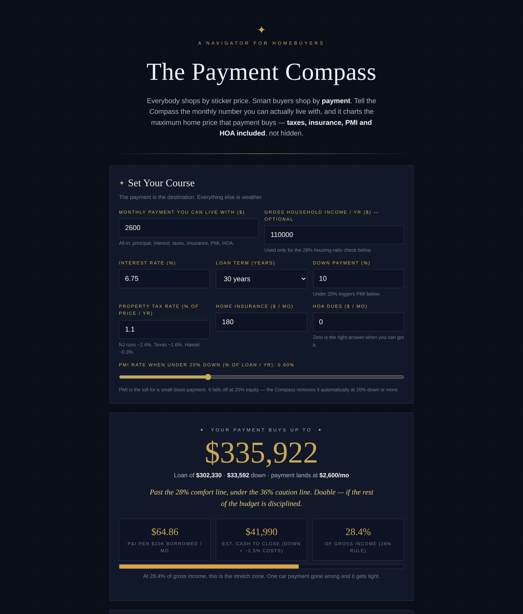

# The Payment Compass — Navigate From Payment to Price

**Live:** https://thebullbrew.github.io/payment-compass/

Everybody shops by sticker price. Smart buyers shop by **payment**. Tell the Compass the monthly
number you can actually live with, and it charts the maximum home price that payment buys —
**taxes, insurance, PMI and HOA included**, not hidden until the closing table.

## What it does

- **The Course** — enter your all-in monthly budget, rate, term, down payment, property-tax rate,
  insurance and HOA. The Compass binary-searches the price ladder and returns the exact maximum
  price whose true monthly cost lands on your budget — plus the loan, the down payment in dollars,
  and estimated cash to close.
- **Anatomy of the Payment** — a stacked breakdown of where the money goes at your max price:
  principal & interest, property tax, insurance, HOA, and the PMI toll when you're under 20% down.
- **The Chart** — a rate × budget map: maximum price for every combination around yours, with your
  position lit in gold. One column left is what a half-point of rate is worth in real dollars.
- **Four Bearings** — instant what-ifs: rate down ½ point, rate up ½ point, +$100/month of budget,
  and the 20%-down course with PMI gone — each with the price delta against your current course.
- **The 28% check** — add your gross income and the Compass grades the payment against the old
  banker's housing-ratio lines (28% comfort / 36% caution) with a plain-spoken verdict.
- **The Ship's Log** — saveable courses in localStorage to compare neighborhoods, lenders, or
  down-payment plans, plus one-click copy of a text summary.

## The method behind it

Most affordability tools ask what price you want and hand you a payment you can't afford. This one
runs the math backwards, the way a careful buyer actually decides: **the payment is fixed, the price
is the unknown.** For any candidate price it builds the true monthly cost — principal & interest,
tax as a percentage of that price, insurance, HOA, and PMI under 20% down — then searches until the
payment lands exactly on budget. Two rules of the sea: a rate is not a price (a half-point moves your
max price more than most negotiations do), and PMI is rent you pay the bank for owning less of your
own house.

## Run it

No backend, no build step. Open `docs/index.html` in any browser (works from `file://`),
or serve the folder statically. Installable as a PWA — works offline.

Built with dark old-money styling (Midnight Cartographer variation) in the daily-apps series.
